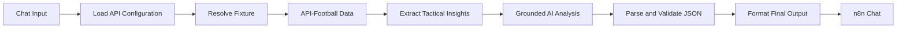
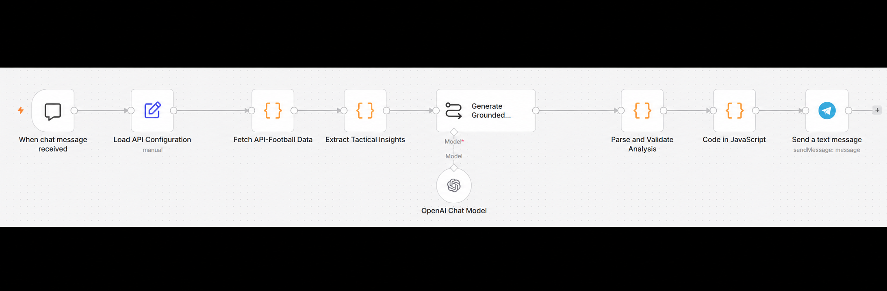
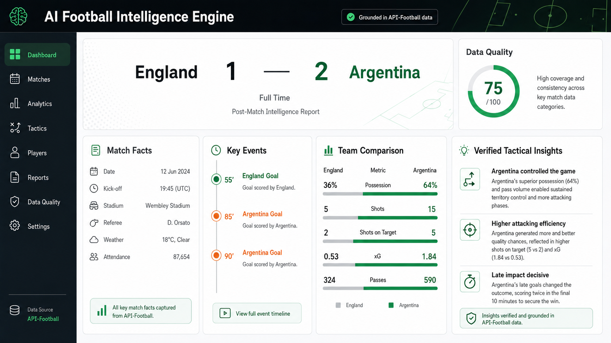
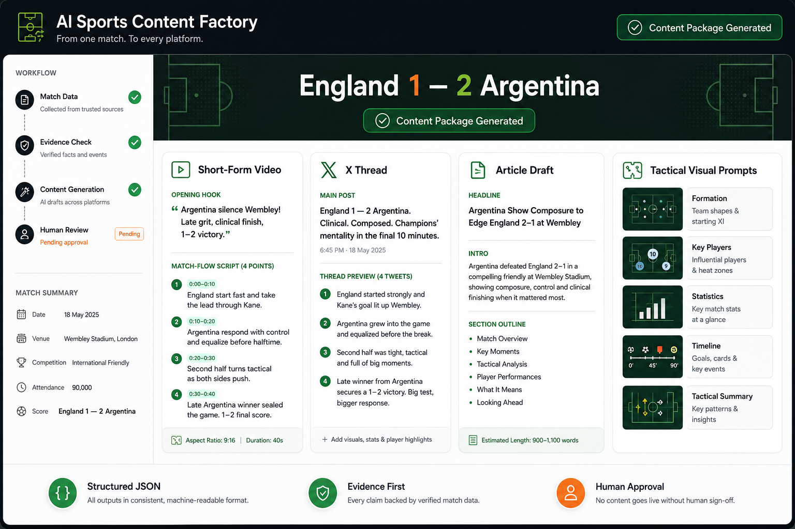

<p align="center"><strong>BADRELDIN — PRODUCTION AI PORTFOLIO</strong><br/><a href="https://github.com/Badrna3om">Profile</a> · <a href="https://github.com/Badrna3om/tactic-ai-media-platform">TACTIC / AMER</a> · <a href="https://github.com/Badrna3om/buaskoor-ai-commerce-platform">Commerce</a> · <a href="https://github.com/Badrna3om/ai-restaurant-operating-system">Restaurant</a> · <a href="https://github.com/Badrna3om/ai-content-automation-for-e-commerce">Marketing</a></p>

# AI Football Intelligence Engine

A standalone football-data intelligence workflow and an **operationally connected repository** that also contains media-rendering components and GitHub Actions used by TACTIC / AMER.

**Repository scope:** The match-analysis workflow is a prototype; this same repository also hosts media automation source and event-triggered production workflows. It is **not a fully sanitized public mirror** of the TACTIC platform. The dedicated [TACTIC × AMER case study](https://github.com/Badrna3om/tactic-ai-media-platform) provides the public, non-technical portfolio overview.

## Live integration and repository disclosure

**Important:** This repository contains more than the standalone intelligence prototype described above. It also contains media-worker and rendering code, event-triggered GitHub Actions, and historical execution artifacts. Some GitHub Actions have been observed receiving real production tasks. **Do not disable, rename, move or delete those workflows without validating upstream dispatchers, credentials, callbacks and downstream consumers.**

For readers interested in business outcomes and sanitized architecture rather than operating source, see the [TACTIC × AMER case study](https://github.com/Badrna3om/tactic-ai-media-platform).

For contribution safety, scope boundaries and the maintenance process, read [SECURITY.md](SECURITY.md) and [REPOSITORY_SCOPE.md](REPOSITORY_SCOPE.md).

## Portfolio quick view

**Evidence-First Football Analysis · Prototype**  
[Workflow](workflow-overview.png) · [Structured report](post-match-intelligence-report.png)

**What this proves:** fact-based data retrieval, identity matching, LLM validation and deterministic failure handling.

> **Disclosure:** This public repository includes operational media code and GitHub Actions. No live credentials are intended to be committed; however, public implementation details and past history should be treated as disclosed. Review [repository scope](REPOSITORY_SCOPE.md) before reuse.

---

## What It Does

- Resolves a match from a Fixture ID or team names
- Supports date-specific lookup without silently selecting another match
- Fetches match facts, team statistics, events, lineups, and player data
- Uses Player IDs to disambiguate abbreviated names
- Scores data completeness before generating analysis
- Separates verified facts from tactical hypotheses
- Produces structured material for articles, X threads, short-form video, and tactical visuals
- Validates the final JSON before returning it to the n8n chat

## Architecture



## Workflow Overview



## Example Input

```text
Argentina vs France 2022-12-18
```

or:

```text
1234567
```

## Example Outputs

### Post-Match Intelligence Report



### Multi-Platform Content Package



## Output Modules

- Data-quality assessment
- Executive match summary
- Verified match facts
- Short-video content material
- Formation and statistical comparison
- Player-impact and turning-point analysis
- Clearly labelled tactical hypotheses
- X thread and article structure
- Five evidence-based tactical image prompts

## Engineering Highlights

- Exact-date fixture validation
- API request tracking
- Parallel data retrieval
- Player identity resolution by Player ID
- Compact structured data to reduce model context
- Evidence-first prompting
- JSON parsing and schema validation
- Clear failure states instead of fabricated fallback data
- Sanitized public workflow with no embedded credentials

## Stack

- n8n
- API-Football
- OpenAI
- JavaScript
- Structured JSON

## Project Direction

This workflow is the post-match intelligence foundation for a larger AI sports newsroom:

1. Daily Match Selector
2. Pre-Match Content Engine
3. Live Match Monitor
4. Post-Match Intelligence
5. Multi-Platform Content Factory
6. Human Approval and Publishing

## Quick Start

See [SETUP.md](SETUP.md). Import the workflow from:

```text
workflows/AI-Football-Intelligence-Engine.json
```

## Security

The public workflow contains no working API keys or OpenAI credential IDs. Never commit secrets. See [SECURITY.md](SECURITY.md).

## Status

Working prototype. API coverage and available statistics vary by competition, match, and subscription plan.
